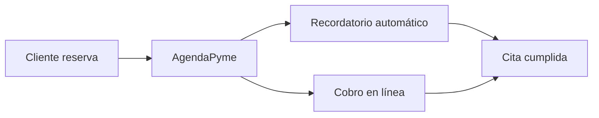

<div align="center">

# 🚀 AgendaPyme

### El asistente que ahorra 10 horas semanales a pequeñas empresas


*Proyecto ficticio con fines académicos. Las cifras son de ejemplo.*

</div>

---

## 😩 El problema

Las pequeñas empresas agendan citas, cobros y recordatorios a mano, en chats y hojas de cálculo. Se pierden clientes por olvidos y se pierde tiempo en tareas repetitivas.

> **Un negocio pequeño dedica horas cada semana a coordinar agendas que un software podría resolver en segundos.**

## 💡 La solución

**AgendaPyme** automatiza citas, recordatorios y cobros desde una sola app.

| Antes | Con AgendaPyme |
|---|---|
| ❌ Agenda en papel y chats | ✅ Calendario único y automático |
| ❌ Clientes que olvidan su cita | ✅ Recordatorios automáticos |
| ❌ Cobros manuales | ✅ Pagos integrados |

## ⚙️ Cómo funciona



## 📈 Tracción (datos de ejemplo)

| Métrica | Valor |
|---|---|
| Estado del producto | Prototipo funcionando |
| Pilotos | 5 negocios (ejemplo) |
| Ingresos | Aún sin monetizar |

## 💰 Modelo de negocio

Suscripción mensual por negocio, con plan básico y plan profesional.

## 🏁 Competencia

| | AgendaPyme | Agenda en papel | Apps genéricas |
|---|---|---|---|
| Recordatorios automáticos | ✅ | ❌ | ✅ |
| Cobros integrados | ✅ | ❌ | ❌ |
| Precio accesible para pymes | ✅ | ✅ | ❌ |

## 🗺️ Roadmap

- [x] Prototipo funcionando
- [x] Pruebas con primeros negocios
- [ ] Trimestre 1: app móvil
- [ ] Trimestre 2: pagos integrados
- [ ] Trimestre 3: expansión regional

## 🎯 Qué pedimos: $10,000,000 USD

| Destino | % | Resultado |
|---|---|---|
| Ingeniería | 40% | Producto estable y escalable |
| Ventas y marketing | 30% | Adquisición de clientes |
| Operaciones | 20% | Soporte y atención |
| Reserva legal | 10% | Estabilidad |

**Con esta inversión lograremos llegar a miles de negocios en 24 meses.**

## 👥 Equipo

| Nombre | Rol |
|---|---|
| [amci] | Fundador / Desarrollo |
| [alfredo] | Producto y negocio |

## 🛠️ Prueba rápida

```bash
git clone https://github.com/AMDAROS-UTTT/prueba-gitignore.git
cd prueba-gitignore
python app.py
```

## 📬 Contacto

**[amci]** · 

> 🔒 Este repositorio usa `.gitignore` para no exponer claves ni archivos sensibles.
